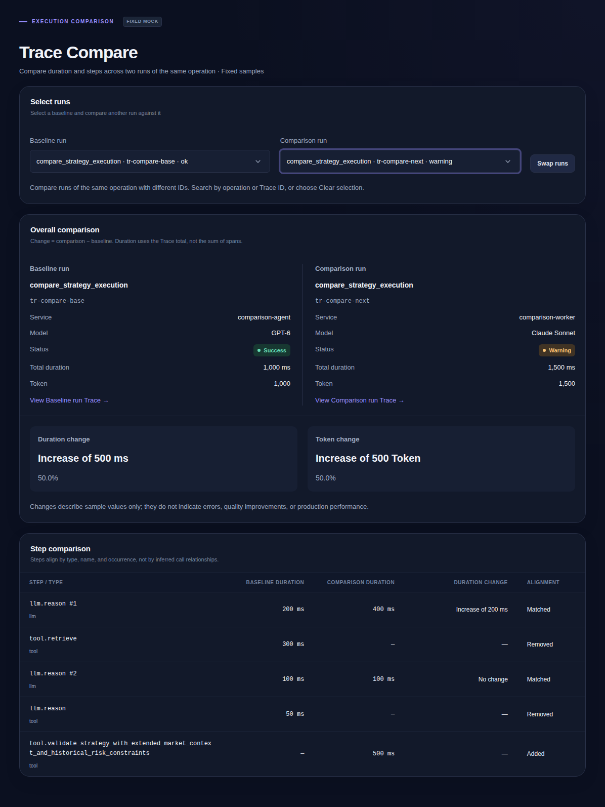

# PulseTrace · Frontend Engineering Lab

A React and TypeScript observability interface for inspecting agent traces, comparing executions, and investigating failures. The project focuses on explicit state rules, testable domain logic, accessible interactions, and reproducible visual regression checks.

**Live demo:** [code-first.vercel.app](https://code-first.vercel.app/) · [Deployment guide](docs/DEPLOYMENT.md)



_Reference screenshot from the tracked Linux baseline. Screenshots are reviewed separately from behavior changes and may lag pending visual changes._

## Features and boundaries

| Route      | Feature        | Implemented behavior                                                                     |
| ---------- | -------------- | ---------------------------------------------------------------------------------------- |
| `/`        | Trace Explorer | Search, status filters, five-row pagination, linked selection, Waterfall and details     |
| `/metrics` | LLM Metrics    | Model summaries, single-model P95, cost sorting and illustrative daily trends            |
| `/errors`  | Error Analysis | Distinct failed-execution counts, filtering, grouping, stable sorting and related traces |
| `/compare` | Trace Compare  | Same-operation run selection, swapping, metric differences and stable step alignment     |

All traces, requests, costs and performance values are **deterministic fixtures, not production measurements**. The app has no backend, real model calls, authentication, streaming, or OpenTelemetry/Sentry integration. It does not claim large-data performance or AI agent runtime capabilities.

Overall P95 is intentionally unavailable: individual model quantiles cannot be averaged into a valid combined quantile without request-level samples or a mergeable distribution. Selecting one model displays its fixture P95. Daily charts remain fixed illustrative trends.

## Run locally

Use Node.js 22.13+ within 22.x, or 24+, and npm. `.nvmrc` selects the latest installed/retrieved Node 22 release, matching CI; the minimum supports the lint toolchain. No environment variables are required.

```bash
npm ci
npm run dev
```

Open `http://127.0.0.1:5173`. Dependencies are locked in `package-lock.json`; use `npm ci` for reproducible installs.

## Check without Docker

```bash
npx playwright install chromium
npm run check
```

`check` runs documentation validation, documentation-checker tests, ESLint (including React Hooks rules), formatting checks, TypeScript checks, a production build, and the full behavior suite against the built app on port 4173. It does not run Docker or approve screenshots.

Tests use Playwright's bundled Chromium. Run browser checks on a supported OS or in a compatible container/CI environment. Canonical screenshot comparisons use the fixed Linux container described below.

Useful individual commands:

```bash
npm test                    # behavior tests against the development server
npm run test:e2e:preview     # build + behavior tests against production output
npm run lint
npm run typecheck
npm run format:check
npm run format              # format the repository, then review the diff
```

Formatting uses the standard Prettier CLI: `format:check` runs `prettier --check .`, and `format` runs `prettier --write .`. Both use `.prettierrc.json` and `.prettierignore`; local checks and CI cover the same repository files without depending on Git history.

The development toolchain temporarily overrides minimatch 7–10 with 11.0.6 to address [GHSA-g3hv-75wg-m249](https://github.com/advisories/GHSA-g3hv-75wg-m249). This affects lint tooling, not browser code. Lint checks exercise its file matching; remove the override when upstream dependencies adopt a patched version.

## CI and visual regression

GitHub Actions runs quality checks for pull requests and pushes to `main`/`master`. A separate pull-request workflow runs screenshot comparisons in the fixed Linux Playwright container. Browser failure traces and screenshot differences are uploaded as artifacts.

```bash
npm run test:visual:docker
```

Docker is only required for canonical screenshot comparisons. The repository contains Linux reference images and legacy macOS references. Local `npm run test:visual` compares against the host-specific images and cannot approve Linux baselines.

Screenshot tests separate shared navigation/topbar regions from page content and Portal popups. Behavior tests still verify overall layout, navigation, keyboard interactions and overflow. A screenshot match does not prove business correctness.

For intentional changes, first inspect the differences, then generate candidates with `npm run test:visual:update`. This updates all visual cases in the container. Review every changed image and obtain human approval before committing baselines; rerun the comparison afterward. See [Validation](docs/VALIDATION.md) for the approval process. A laptop without Docker can run behavior checks and leave canonical visual verification pending CI or another Docker-enabled environment.

## Engineering decisions worth reviewing

- **Stable step matching:** [comparison.ts](src/pages/TraceCompare/comparison.ts) matches exact type/name pairs by occurrence, preserves output order, distinguishes missing steps from zero duration, and does not mutate inputs. It does not infer real call relationships.
- **Failure aggregation:** [analysis.ts](src/pages/ErrorAnalysis/analysis.ts) derives service/model information from linked failed traces, deduplicates per execution using the latest event, and applies deterministic tie-breaking.
- **URL and local state:** [TraceExplorer.tsx](src/pages/TraceExplorer.tsx) supports refreshable trace links while keeping search, filters, pagination and visible details consistent.
- **Searchable selection:** [TracePicker.tsx](src/pages/TraceCompare/TracePicker.tsx) manages a viewport-bounded Portal popup with keyboard navigation and active-descendant semantics.
- **Verification boundaries:** shared screenshot regions reduce unrelated baseline churn; behavior tests exercise the resulting application rather than relying solely on screenshots.

The current fixture size does not justify global state management, virtualization or a generic chart framework. These would need concrete data-volume or product requirements.

## Structure and documentation

| Location                        | Responsibility                                   |
| ------------------------------- | ------------------------------------------------ |
| `src/router/`                   | Route registration, shared navigation metadata   |
| `src/components/ui/`            | UI primitives                                    |
| `src/components/observability/` | Trace and chart views                            |
| `src/pages/`                    | Page state, composition and private domain logic |
| `src/data/`                     | Deterministic fixtures                           |
| `src/styles/`                   | Shared tokens and base styles                    |
| `tests/`                        | Behavior and screenshot acceptance criteria      |

Contributor references: [Agent agreement](AGENTS.md), [Workflow](docs/WORKFLOW.md), [Validation](docs/VALIDATION.md), [UI guidelines](docs/UI_GUIDELINES.md), [Code guidelines](docs/CODE_GUIDELINES.md).

Component contracts: [Button](docs/components/ui/Button.md), [MetricCard](docs/components/ui/MetricCard.md), [TraceTable](docs/components/observability/TraceTable.md). Feature details: [Trace Compare](docs/features/done/trace-compare.md), [Error Analysis](docs/features/done/error-analysis.md).

The documentation checker validates local Markdown link targets and standard-document dependency cycles. It does not verify external links, prose accuracy, anchors, or screenshot approval.

**Usage permission:** this example's code may be used for personal learning and modification. No third-party images, brand assets or proprietary SDKs are included.
